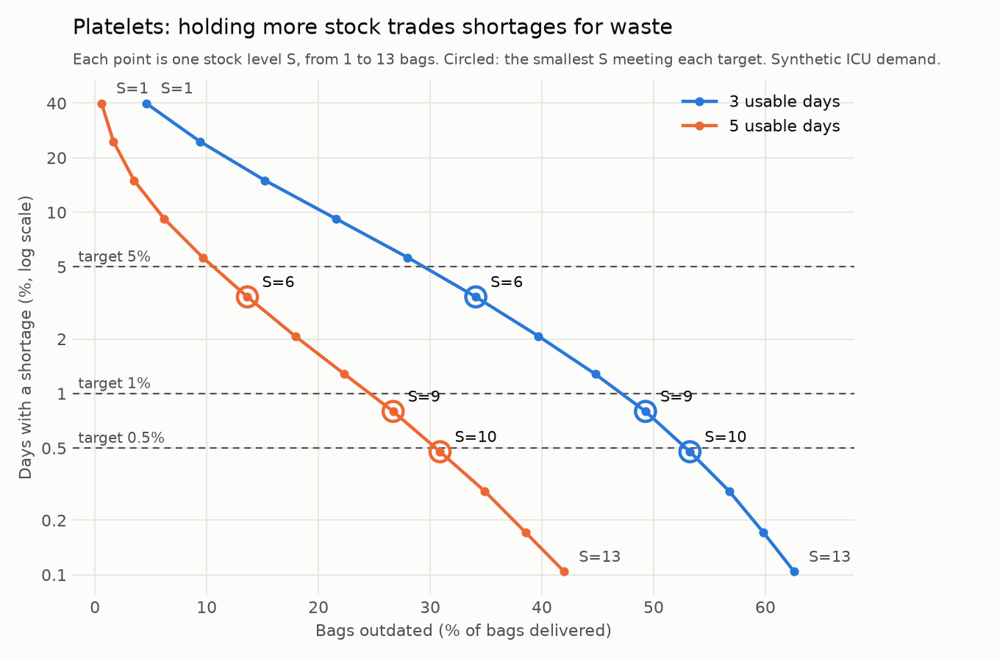
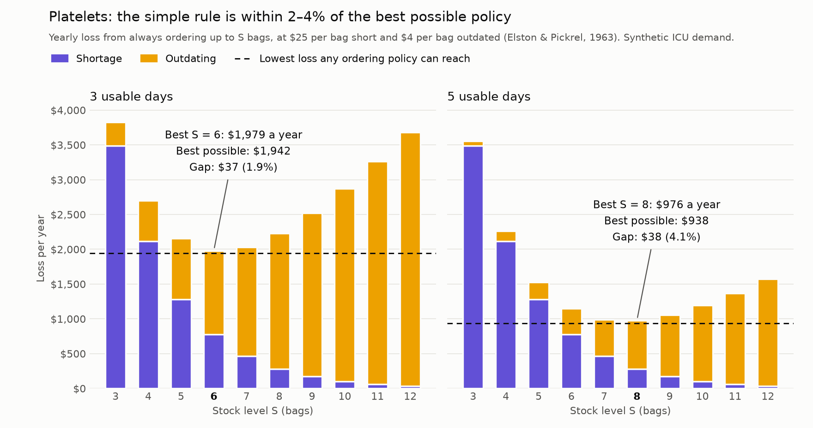

# Elston and Pickrel Revisited

[](https://github.com/jpb-1729/elston-pickrel-revisited/actions/workflows/ci.yml)

This project revisits Elston and Pickrel’s (1963) perishable inventory management policy for a hospital blood bank. Managing inventory in this environment is difficult: too little inventory risks shortages, and too much inventory risks waste from outdated supply. The authors use an order-up-to-S policy, where S is the target for stock on hand plus stock on order, combined with FIFO, and found that more complex rules did not perform much better. This repo goes one step further and demonstrates that, under the fitted demand model, this simple rule can incur only a few percent more expected loss than an optimized ordering policy, and examines the tradeoffs across stock levels S.

## Data

The full MIMIC-IV database needs credentialed access, so the main results use
synthetic data built to look like it. `generate_synthetic_mimic.py` writes the
five MIMIC-IV tables the analysis needs, with the same columns. Demand mostly
follows the Elston & Pickrel model, with deliberate departures: patient
frailty, repeat episodes, weekday effects, drift over time and a heavy tail.
The data also has the recording problems of real ICU records: bags split across
rows, corrected rows, duplicates, one item recorded in donor units, and
per-patient date shifting. Unlike MIMIC-IV, the synthetic date shifts preserve
the day of the week, allowing weekday effects to be studied in the synthetic
data. The true parameters go to a sealed answer key, so
`phase2/grade.py` can check the fitted model against them. The same SQL runs on
the open MIMIC-IV demo with only the item IDs changed.

## Getting Started

Needs [uv](https://docs.astral.sh/uv/) and the
[DuckDB command-line client](https://duckdb.org/docs/installation/). From the
project root:

```sh
uv sync
uv run python generate_synthetic_mimic.py --out synth --seed 42
(cd synth && duckdb synth.duckdb < load_duckdb.sql)

duckdb synth/synth.duckdb < sql/phase2.sql   # bags → episodes, exports to phase2/
uv run python phase2/fit.py                  # fits the demand models
uv run python stocking/run.py                # shortage vs. outdating for each S
uv run python stocking/optimal.py            # order-up-to-S vs. the optimal policy
```

To run the pipeline on real data, put the `hosp/` and `icu/` folders of the
[MIMIC-IV Clinical Database Demo](https://physionet.org/content/mimic-iv-demo/2.2/)
in `mimic_demo/` and run `tools/mimic_demo.sh`. Tests: `uv run pytest`.

The results below come from one unseeded run of 50,000 patients. Each run draws
new true parameters, so rerunning gives different numbers and overwrites the
committed results. The conclusion holds: with `--seed 42`, order-up-to-S comes
within 2.4% and 4.2% of the optimal expected loss under the fitted demand model.

## Evaluating the stocking policy

Each evening the blood bank orders enough to bring stock on hand plus stock on
order back up to S bags.
Bags are issued oldest first and expire when their shelf life runs out. Daily
demand comes from the fitted Elston & Pickrel model.



Platelets (about 1.7 bags a day) show the trade-off. Keeping days with any
shortage to 5% takes S = 6. At that level 34% of bags expire with 3 usable days, and 14%
with 5 usable days. At a 0.5% target, it's 53% and 31%. No red-cell or
frozen-plasma expirations were observed at these targets during the
200,000-day simulations.



Order-up-to-S ignores the age of the stock. It was compared against an ordering
policy optimized using a Markov decision process that tracks inventory by age,
with shortages and outdates weighted 25:4 as in Elston & Pickrel. Under the
fitted demand model, the best order-up-to-S policy incurs only 1.9% and 4.1%
more expected annual loss than the optimized ordering policy for three- and
five-day usable lifetimes, respectively. Both policies assume independent
daily demand and next-morning replenishment.

## Future work

The next step is to fit the demand model on the full MIMIC-IV database instead
of synthetic data. MIMIC-IV has real limits for this question:

- Dates are shifted per patient, so the hospital's true day-by-day demand
  can't be rebuilt. Weekdays and seasons are not preserved, although intervals
  within a patient's timeline remain intact and `anchor_year_group` gives a
  3-year range for the patient's anchor year. See the
  [MIMIC-IV date-shifting documentation](https://physionet.org/content/mimic-iv-demo/2.2/#methods).
- It records transfusions given in the ICU, not the whole hospital's blood
  bank, and it has no supply-side data: no orders, stock levels or expired bags.
- It comes from a single academic hospital.

Even so, it can answer questions the 1963 data couldn't:

- **Does the model still fit?** Test whether a logarithmic number of bags per
  episode holds on thousands of real ICU stays, or whether a heavier-tailed
  distribution fits better.
- **Who drives demand?** Diagnoses and procedures are linked to each hospital
  admission, and care units to each ICU stay, so demand can be modelled by
  patient group, not only as one total.
- **Change over time.** The 3-year periods show whether transfusion practice,
  and so the right stock level, drifted over the years.

## References

Elston, R. C., & Pickrel, J. C. (1963). A statistical approach to ordering and
usage policies for a hospital blood bank. *Transfusion*, 3(1), 41–47.
https://doi.org/10.1111/j.1537-2995.1963.tb04602.x

Johnson, A. E. W., Bulgarelli, L., Shen, L., et al. (2023). MIMIC-IV, a freely
accessible electronic health record dataset. *Scientific Data*, 10, 1.
https://doi.org/10.1038/s41597-022-01899-x

Johnson, A., Bulgarelli, L., Pollard, T., Horng, S., Celi, L. A., & Mark, R.
(2023). MIMIC-IV Clinical Database Demo (version 2.2). PhysioNet.
https://doi.org/10.13026/dp1f-ex47

Goldberger, A. L., Amaral, L. A. N., Glass, L., et al. (2000). PhysioBank,
PhysioToolkit, and PhysioNet: Components of a new research resource for complex
physiologic signals. *Circulation*, 101(23), e215–e220.
https://doi.org/10.1161/01.CIR.101.23.e215
